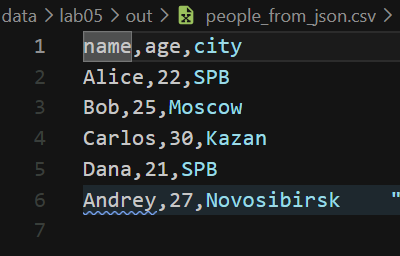
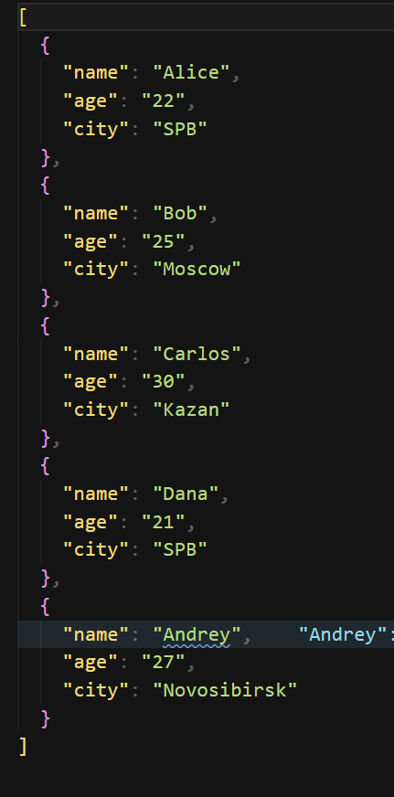
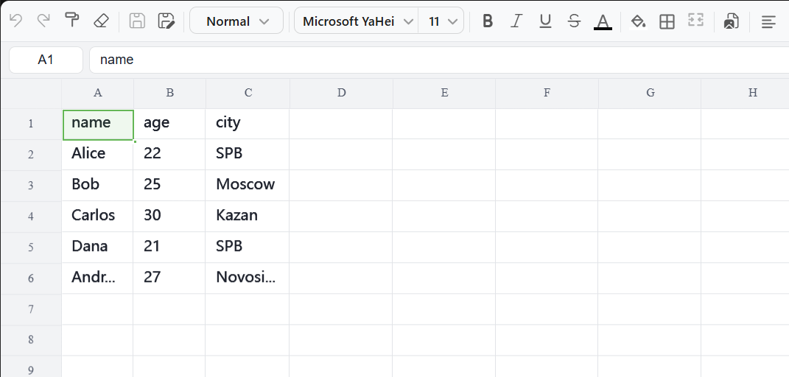

# Отчет по лабораторной работе №5 — JSON, CSV и XLSX

## Структура лабораторной работы

- `src/lab05/json_csv.py` — преобразование JSON в CSV и CSV в JSON;
- `src/lab05/csv_xlsx.py` — преобразование CSV в XLSX.

Входные примеры находятся в каталоге `data/lab05/samples/`, а результаты
конвертаций — в каталоге `data/lab05/out/`.

## Задание A — JSON ↔ CSV

Модуль [json_csv.py](./json_csv.py) содержит две функции.

### Функция `json_to_csv`

```python
def json_to_csv(json_path: str, csv_path: str) -> None:
    jp = Path(json_path)
    cp = Path(csv_path)

    if not jp.exists():
        raise FileNotFoundError("Указанный JSON файл не найден")

    if jp.suffix.lower() != '.json':
        raise ValueError("Указанный файл не формата JSON")

    with jp.open('r', encoding='utf-8') as p:
        try:
            data = json.load(p)
        except json.JSONDecodeError:
            raise ValueError("Пустой JSON или неподдерживаемая структура")

    if not isinstance(data, list) or len(data) == 0:
        raise ValueError('Файл JSON пустой или имеет неправильный формат')
    if not all(isinstance(item, dict) for item in data):
        raise ValueError("Все элементы списка JSON должны быть словарями")

    ensure_parent_dir(cp)
    fieldnames = {}
    for element in data:
        for key in element.keys():
            fieldnames[key] = None

    with cp.open('w', newline="", encoding='utf-8') as f:
        w = csv.DictWriter(f, fieldnames=list(fieldnames.keys()))
        w.writeheader()
        w.writerows(data)
```

Функция:

1. проверяет существование входного файла;
2. проверяет расширение `.json`;
3. читает JSON в кодировке UTF-8;
4. проверяет, что корневой объект является непустым списком словарей;
5. собирает названия всех ключей в порядке их первого появления;
6. записывает заголовок и строки в CSV в кодировке UTF-8.

Если в одном из словарей отсутствует ключ, `csv.DictWriter` записывает в
соответствующую ячейку пустое значение.

Пример вызова:

```python
json_to_csv(
    "data/lab05/samples/people.json",
    "data/lab05/out/people_from_json.csv",
)
```

### Функция `csv_to_json`

```python
def csv_to_json(csv_path: str, json_path: str) -> None:
    jp = Path(json_path)
    cp = Path(csv_path)

    if not cp.exists():
        raise FileNotFoundError("Указанный CSV файл не найден")

    if cp.suffix.lower() != '.csv':
        raise ValueError("Указанный файл не формата CSV")

    with cp.open("r", newline="", encoding="utf-8") as f:
        reader = csv.DictReader(f)
        if reader.fieldnames is None:
            raise ValueError("Файл CSV пустой")

        data = list(reader)

    if not data:
        raise ValueError("Файл CSV не содержит данных")

    ensure_parent_dir(jp)
    with jp.open('w', encoding='utf-8') as p:
        json.dump(data, p, ensure_ascii=False, indent=2)
```

Функция:

1. проверяет существование входного файла;
2. проверяет расширение `.csv`;
3. читает CSV в кодировке UTF-8;
4. проверяет наличие заголовка и хотя бы одной строки данных;
5. преобразует каждую строку в словарь;
6. сохраняет список словарей в JSON с отступом в два пробела.

Пример вызова:

```python
csv_to_json(
    "data/lab05/samples/people.csv",
    "data/lab05/out/people_from_csv.json",
)
```

### Запуск модуля JSON ↔ CSV

Из корня репозитория:

```powershell
python -m src.lab05.json_csv
```

При таком запуске создаются:

- `data/lab05/out/people_from_csv.json`;
- `data/lab05/out/people_from_json.csv`.

## Задание B — CSV → XLSX

Модуль [csv_xlsx.py](./csv_xlsx.py) содержит функцию:

```python
def csv_to_xlsx(csv_path: str, xlsx_path: str) -> None:
    cp = Path(csv_path)
    xlp = Path(xlsx_path)

    if not cp.exists():
        raise FileNotFoundError("Указанный CSV файл не найден")

    if cp.suffix.lower() != '.csv':
        raise ValueError("Указанный файл не формата CSV")

    with cp.open('r', newline='', encoding='utf-8') as f:
        reader = list(csv.reader(f))

    if not reader:
        raise ValueError("Файл CSV пустой")

    wb = Workbook()
    ws = wb.active
    assert ws is not None
    ws.title = "Sheet1"
    for row in reader:
        ws.append(row)

    for col in ws.columns:
        max_len = 0
        letter = col[0].column_letter

        for cell in col:
            if cell.value and len(str(cell.value)) > max_len:
                max_len = len(str(cell.value))

        ws.column_dimensions[letter].width = max(max_len, 8)

    ensure_parent_dir(xlp)
    wb.save(xlp)
```

Функция:

1. проверяет существование CSV-файла;
2. проверяет расширение `.csv`;
3. читает строки в кодировке UTF-8;
4. создаёт книгу Excel с помощью `openpyxl`;
5. добавляет строки CSV на лист `Sheet1`;
6. рассчитывает ширину столбцов;
7. сохраняет результат по указанному пути.

Ширина столбца вычисляется по самому длинному текстовому значению в столбце:

```python
ws.column_dimensions[letter].width = max(max_len, 8)
```

Пример вызова:

```python
csv_to_xlsx(
    "data/lab05/samples/people.csv",
    "data/lab05/out/people.xlsx",
)
```

### Запуск модуля CSV → XLSX

```powershell
python -m src.lab05.csv_xlsx
```

После запуска создаётся файл `data/lab05/out/people.xlsx`.

## Обработка ошибок

Входные функции явно сообщают об ошибках:

- `FileNotFoundError` — входной файл не найден;
- `ValueError` — расширение файла не соответствует ожидаемому формату;
- `ValueError` — JSON пустой, имеет неподдерживаемую структуру или содержит
  элементы не-словари;
- `ValueError` — CSV пустой или не содержит строк данных.

Родительский каталог выходного файла создаётся функцией
`ensure_parent_dir()` из `src.lib.often_func`, поэтому выходные каталоги должны
создаваться автоматически.

## Примеры данных и результаты

Для демонстрации используются следующие файлы:

- `data/lab05/samples/people.json` — список людей в формате JSON;
- `data/lab05/samples/people.csv` — те же данные в формате CSV;
- `data/lab05/samples/cities.csv` — дополнительный CSV с городами;
- `data/lab05/out/people_from_json.csv` — результат JSON → CSV;
- `data/lab05/out/people_from_csv.json` — результат CSV → JSON;
- `data/lab05/out/people.xlsx` — результат CSV → XLSX.

## Проверка результатов

### 1. JSON → CSV



*Рис. 1. Результат преобразования JSON в CSV.*

### 2. CSV → JSON



*Рис. 2. Результат преобразования CSV в JSON.*

### 3. CSV → XLSX



*Рис. 3. Результат преобразования CSV в XLSX.*
