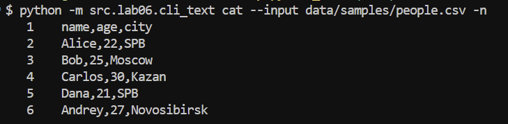
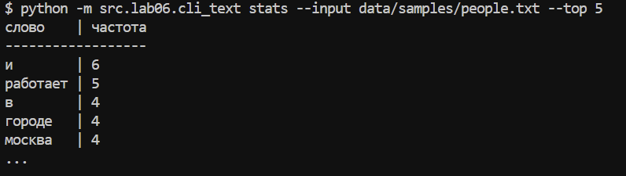
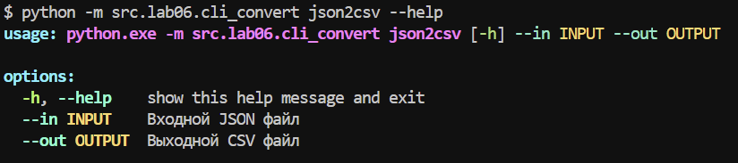
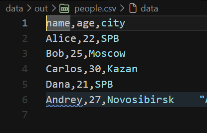
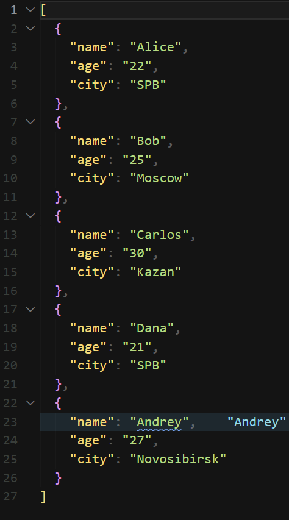
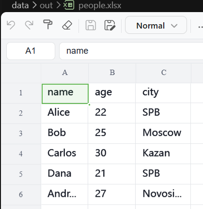
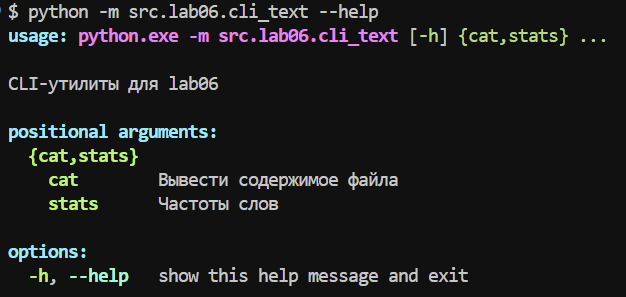
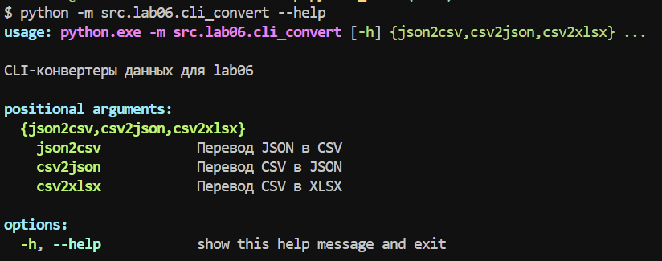

# Отчет по лабораторной работе №6

## Задание A — текстовые CLI-утилиты

Модуль `cli_text.py` содержит подкоманды `cat` и `stats`.

### Подкоманда `cat`

Подкоманда выводит содержимое текстового файла построчно.

```powershell
python -m src.lab06.cli_text cat --input data\lab04\input.txt
```

Для нумерации строк используется флаг `-n`:

```powershell
python -m src.lab06.cli_text cat --input data\lab04\input.txt -n
```

Параметры:

- `--input` — обязательный путь к входному файлу;
- `-n` — необязательный флаг нумерации строк.



*Рис. 1. Работа подкоманды `cat` с флагом `-n`.*

### Подкоманда `stats`

Подкоманда подсчитывает частоты слов в текстовом файле. Для обработки
используются функции из [src/lib/text.py](../lib/text.py):

1. `normalize()` — нормализация текста;
2. `tokenize()` — выделение слов;
3. `count_freq()` — подсчёт частот;
4. `top_n()` — сортировка и выбор наиболее частых слов.

Запуск с количеством слов по умолчанию:

```powershell
python -m src.lab06.cli_text stats --input data\lab04\input.txt
```

Запуск с собственным размером топа:

```powershell
python -m src.lab06.cli_text stats --input data\lab04\input.txt --top 5
```

Параметры:

- `--input` — обязательный путь к текстовому файлу;
- `--top` — количество слов в результате, по умолчанию `5`.



*Рис. 2. Работа подкоманды `stats`.*

## Задание B — CLI-конвертеры

Модуль `cli_convert.py` предоставляет три подкоманды. Внутри используются
функции из лабораторной работы №5:

- `json_to_csv()` из `src.lab05.json_csv`;
- `csv_to_json()` из `src.lab05.json_csv`;
- `csv_to_xlsx()` из `src.lab05.csv_xlsx`.

Для всех конвертеров обязательны параметры:

- `--in` — путь к входному файлу;
- `--out` — путь к выходному файлу.

### Подкоманда `json2csv`

Преобразует JSON со списком словарей в CSV:

```powershell
python -m src.lab06.cli_convert json2csv `
  --in data\lab05\samples\people.json `
  --out data\lab05\out\people_from_json.csv
```



*Рис. 3. Справка по подкоманде `json2csv`.*



*Рис. 4. Результат запуска `json2csv`.*

### Подкоманда `csv2json`

Преобразует CSV с заголовком в JSON-список словарей:

```powershell
python -m src.lab06.cli_convert csv2json `
  --in data\lab05\samples\people.csv `
  --out data\lab05\out\people_from_csv.json
```



*Рис. 5. Результат запуска `csv2json`.*

### Подкоманда `csv2xlsx`

Преобразует CSV в таблицу XLSX:

```powershell
python -m src.lab06.cli_convert csv2xlsx `
  --in data\lab05\samples\people.csv `
  --out data\lab05\out\people.xlsx
```



*Рис. 6. Результат запуска `csv2xlsx`.*

## Справка `--help`

Справка всего CLI:

```powershell
python -m src.lab06.cli_text --help
python -m src.lab06.cli_convert --help
```

Справка отдельных подкоманд:

```powershell
python -m src.lab06.cli_text cat --help
python -m src.lab06.cli_text stats --help
python -m src.lab06.cli_convert json2csv --help
python -m src.lab06.cli_convert csv2json --help
python -m src.lab06.cli_convert csv2xlsx --help
```



*Рис. 7. Справка текстовых подкоманд.*



*Рис. 8. Справка конвертеров.*

## Обработка ошибок

При отсутствии входного файла программы вызывают `FileNotFoundError` с
понятным сообщением о пути к файлу.

Ошибки формата входных файлов и пустых файлов обрабатываются функциями из
лабораторных работ №4 и №5. Ошибки обязательных аргументов и неизвестных
параметров обрабатываются самим `argparse`, который выводит сообщение об
ошибке и справку по использованию команды.

## Проверка работы

Для проверки были выполнены следующие сценарии:

1. `cat --input data\lab04\input.txt -n` — вывод файла с номерами строк;
2. `stats --input data\lab04\input.txt --top 5` — вывод пяти наиболее частых
   слов;
3. `json2csv` — конвертация JSON в CSV;
4. `csv2json` — конвертация CSV в JSON;
5. `csv2xlsx` — конвертация CSV в XLSX;
6. `--help` для общего CLI и каждой подкоманды.

Результаты конвертаций сохраняются в `data\lab05\out\`, а скриншоты запусков
находятся в `images\lab06\`.

## Зависимости

Сам CLI использует стандартный модуль `argparse`, а также `pathlib` и функции
из предыдущих лабораторных работ. Для команды `csv2xlsx` транзитивно требуется
`openpyxl`, потому что она вызывает реализацию CSV → XLSX из ЛР5.

Установка зависимостей из корня репозитория:

```powershell
python -m pip install -r requirements.txt
```
